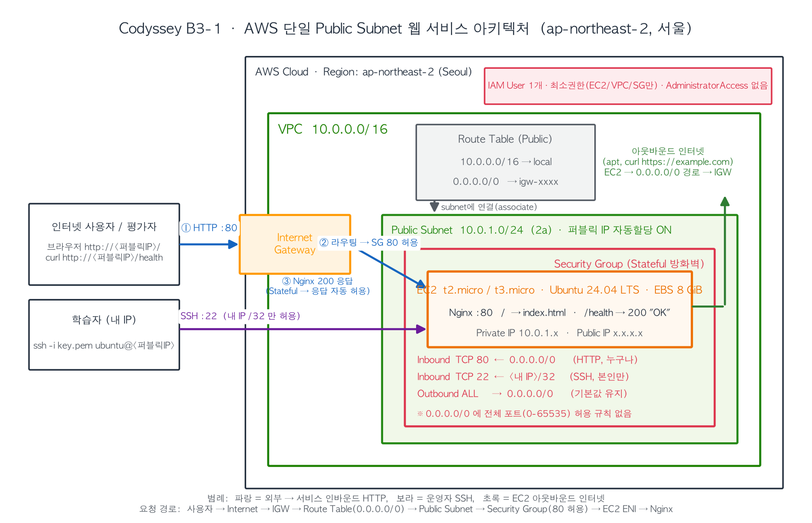

# 아키텍처 설명 (docs/architecture.png 의 해설)

> 제출 규격 파일은 `docs/architecture.png` 이며, 이 문서는 다이어그램의 각 요소와 트래픽 흐름을 글로 설명한다.
> 재생성: `python3 scripts/make_architecture_diagram.py` (matplotlib 필요). 실제 퍼블릭 IP 등을 반영하려면 스크립트의 문자열을 바꾸고 다시 실행한다.

## 구성 요소

| 요소 | 값 | 역할 |
|---|---|---|
| Region | ap-northeast-2 (서울) | 모든 리소스의 위치. 미션 제약 |
| VPC | `10.0.0.0/16` | 계정 안의 **격리된 가상 네트워크**. 이 안에서만 사설 IP 가 유효 |
| Public Subnet | `10.0.1.0/24`, AZ 2a, 퍼블릭 IP 자동할당 ON | VPC 를 쪼갠 조각. "퍼블릭"인 이유는 **라우트 테이블에 IGW 경로가 있기 때문**이지 이름 때문이 아님 |
| Internet Gateway | `b3-1-igw`, VPC 에 attach | VPC 와 인터넷 사이의 **양방향 관문**. 퍼블릭 IP ↔ 사설 IP 1:1 NAT 수행 |
| Route Table | `10.0.0.0/16 → local`, `0.0.0.0/0 → igw` | 서브넷에서 나가는 패킷의 **다음 목적지 결정**. 서브넷에 명시적으로 연결 |
| Security Group | 80 ← 0.0.0.0/0, 22 ← 내 IP/32, Outbound ALL | 인스턴스(ENI) 단위 **Stateful 방화벽**. 허용 규칙만 존재 |
| EC2 | t2.micro, Ubuntu 24.04, EBS 8GiB, Nginx | 웹 서버. `/` → index.html, `/health` → `200 OK` |
| IAM User | `b3-1-operator`, 최소권한 정책 | **사람/도구가 AWS API 를 호출할 권한**. 패킷과 무관 |

## 트래픽 흐름

### ① 외부 사용자 → 웹 서비스 (인바운드 HTTP)
1. 사용자가 `http://<퍼블릭IP>/health` 요청 → 인터넷을 거쳐 AWS 네트워크 도착
2. **Internet Gateway** 가 퍼블릭 IP 를 인스턴스의 사설 IP(10.0.1.x)로 변환(1:1 NAT)
3. 패킷이 서브넷의 ENI 에 도달하기 전 **Security Group** 인바운드 검사: TCP 80, 소스 0.0.0.0/0 → 허용
4. Nginx 가 `/health` 에 대해 `200 OK` 응답
5. 응답 패킷은 SG 가 **Stateful** 이므로 별도 아웃바운드 규칙 없이 통과 → 라우트 테이블 `0.0.0.0/0 → igw` → IGW 가 사설 IP 를 퍼블릭 IP 로 되돌려 사용자에게 전달

### ② 학습자 → SSH
동일 경로이나 SG 규칙이 **TCP 22, 소스 `<내 IP>/32`** 이므로 다른 IP 는 SYN 단계에서 드롭된다(응답 없음 → 클라이언트는 timeout 을 본다).

### ③ EC2 → 인터넷 (아웃바운드: apt, curl example.com)
1. 인스턴스가 `93.184.216.34:443` 으로 패킷 전송
2. SG 아웃바운드 ALL 허용
3. 라우트 테이블에서 `0.0.0.0/0` 매칭 → IGW 로 전달
4. IGW 가 사설 IP → 퍼블릭 IP 로 변환해 외부로 전송. **퍼블릭 IP 가 없으면 이 단계에서 실패** (프라이빗 서브넷이라면 NAT Gateway 필요)

## 외부 요청이 Nginx 까지 도달하기 위한 필수 조건 (셋 중 하나라도 빠지면 실패)

| 조건 | 빠졌을 때 증상 |
|---|---|
| 서브넷의 라우트 테이블에 `0.0.0.0/0 → IGW` + IGW 가 VPC 에 attach | 모든 외부 통신 timeout, 인스턴스 안에서도 `curl example.com` 실패 |
| 인스턴스에 퍼블릭 IPv4 (자동할당 또는 EIP) | 접속할 주소 자체가 없음 |
| SG 인바운드에 해당 포트·소스 허용 | 해당 포트만 timeout (다른 포트는 됨) |
| (+ 서버 프로세스가 포트에서 listen) | **connection refused** — 네트워크는 통했으나 프로세스 없음 |

## 왜 이 구성이 "최소권한·최소노출" 인가
- 인바운드는 서비스 포트(80)와 운영 포트(22)만, 운영 포트는 소스 /32 로 제한
- IAM 은 EC2/VPC/SG 작업만 허용하고 NAT/ELB/RDS/S3 는 명시적 Deny, 인스턴스 타입도 micro 로 제한
- 프라이빗 서브넷·NAT 가 없으므로 과금 요소가 EC2 + EBS 뿐 (프리 티어 범위)
